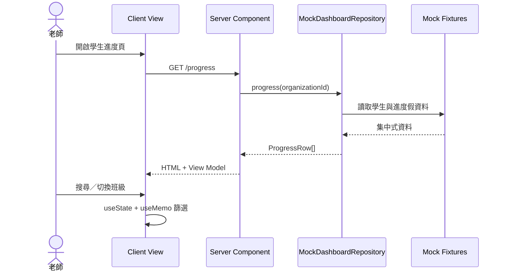
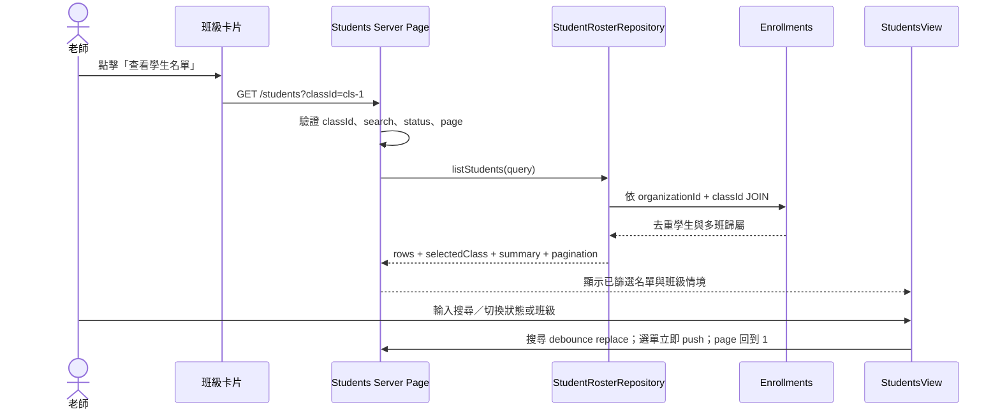
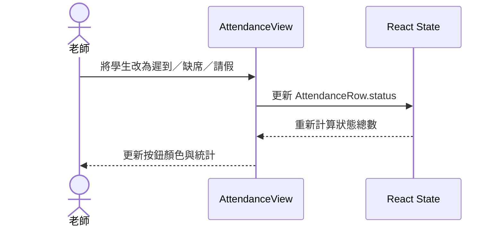
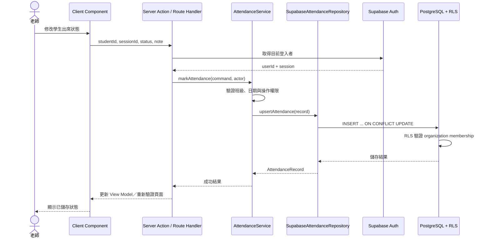
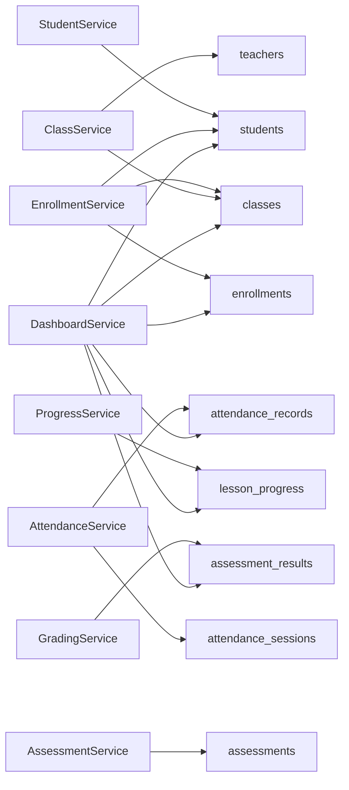
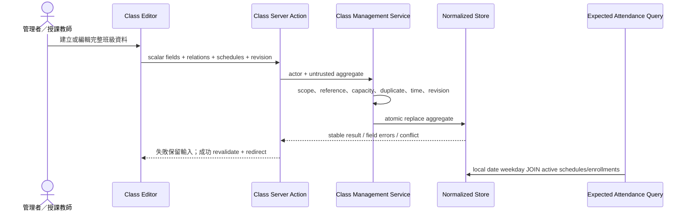
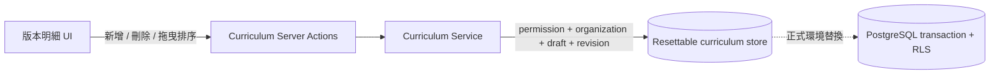
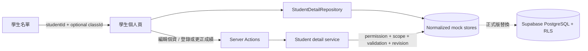

# UI 與後端操作流程

## 1. 操作狀態總覽

| 畫面 | UI 操作 | 現行行為 | 未來後端 Action |
|---|---|---|---|
| 學生進度 | 搜尋、班級篩選 | Client 記憶體篩選 | 大資料量時改成帶查詢參數的分頁查詢 |
| 學生名單 | 班級、搜尋、狀態、分頁 | URL query 驅動 Server Repository；由 enrollment JOIN | 換 Supabase Repository 後沿用 `listStudents(query)` 合約 |
| 課程班級 | 搜尋、年級篩選、查看學生名單 | Client 篩選；班級卡片連到 `/students?classId=<id>` | `listClasses`；建立班級使用 `createClass` |
| 出缺席 | 日期、班級、切換狀態 | 狀態只保存在目前瀏覽器 session | `upsertAttendanceRecord` |
| 學習指標 | 查看趨勢與分布 | Server 取得 Mock 統計 | `getAnalytics`，由 SQL aggregate/view 計算 |
| 帳號管理 | 篩選、角色／狀態調整 | Server Action → AccessService → Mock Store | 未來替換為 Supabase membership tables |
| 角色權限 | 檢視與儲存權限 | Server Action → 權限相依／版本檢查 → Mock Store | 未來加入 audit log 與 RLS |

所有管理寫入都由 Server 重新解析 Actor；UI 隱藏按鈕不是安全邊界。最後一位 Owner 不可停用或降級，主任不能異動 Owner 或系統角色，無權或跨組織目標採 fail-closed。學生使用 `self-student` scope，家長使用 server-owned `linked-students` scope；老師使用 `assigned-classes`。

Mock 身分切換流程為 `Shell selector → selectPersona Server Action → HttpOnly persona cookie → identity-core → recommended route redirect`。正式版會把 Cookie persona 替換成 Supabase Session，但保留 client-safe persona 說明、權限碼與 Repository／Service 驗證邊界。

## 班級今日課堂進度

課堂日期由 `ClassSessionDateNavigation` 選擇後直接以 `router.push` 更新 URL，不需提交切換按鈕。Transition 期間顯示「正在載入課堂…」並停用舊課堂表單；新日期的 workspace 使用 class/date key 重新初始化，避免暫存進度跨日。日期導航移除前次 notice/tone，但不改資料庫或授權規則。

Supabase provider：讀取經 `class-session-supabase.ts → open_class_daily_workspace`；四個寫入 Action 經 `class-session-persistence-service → mutate_class_daily_progress`。RPC 使用使用者 JWT 與 membership helper 驗證範圍，不使用 secret key。資料庫交易一次更新課堂版本、進度歷史及目前學習項目；失敗不 fallback 到 Mock。兩個 RPC 需先套用 `202610100001_class_session_functions.sql`。

此接線不包含 `/attendance` 編輯器。今日課堂只使用資料庫 active plan；記憶體計畫不會被當成已持久化資料。

教材／修課計畫現由 `curriculum-persistence-service` 依 domain provider 分流。Supabase 模式用 `mutate_curriculum_workspace` 原子建立／發布／複製／封存教材、增刪與排序草稿項目、更換學生計畫、更新 active 學習項目；查詢用 `read_curriculum_workspace`。成功才刷新資料；失敗顯示安全訊息，missing migration/network 不 fallback。建立教材成功導向新草稿；發布與更換計畫保留結果通知。複製／發布附 version revision；個人進度更新附 item revision，舊計畫與 removed 項目唯讀。上述接線需 `202610100002_curriculum_functions.sql`。

```text
/classes/[classId]?date=YYYY-MM-DD
  → ClassSessionRepository 建立或讀取 ClassSession 與成員快照
  → 依每位 studentId JOIN active Study Plan 與 StudentLearningItem
  → 老師選擇學習項目、pending / in_progress / completed、選填 note
  → saveDailyProgressAction
  → ClassSessionService 驗證 organization、assigned class、member、plan、item、revision
  → 全部通過後 append StudentSessionProgress 並更新 StudentLearningItem
```

- 班級只決定當次成員，不決定教材版本。
- 一位學生一堂課可有多筆不同教材進度。
- 請假／缺席預設 `本次不更新`；沒有 entry 就不改目前進度。
- 更正會新增帶有 `supersedesId` 與原因的後續紀錄，不覆蓋原歷史。
- 草稿課堂可先新增／調整多筆進度，最後按「統一更新課堂進度」一次送出。
- 已完成課堂不開放一般覆寫，但可批次補登缺少的進度；老師需填一次補登原因，系統 append 新歷史並同步目前狀態。

## 2. 現行讀取流程



學生進度頁的搜尋仍是 Client 記憶體篩選；學生名單已改成 URL 驅動的 Server 查詢。

## 2.1 班級卡片到學生名單



學生名單不提供獨立搜尋或清除按鈕。班級與狀態選單的空值「全部」會移除該 URL 條件；搜尋輸入完成後自動更新。篩選切換只局部重繪資料，不顯示 Toast、Modal 或浮動提示。

`classId` 不存在或不屬於目前 organization 時採 fail-closed：不顯示該班資料，
也不退回總名單。合法但沒有符合學生時，則顯示可清除條件的空結果。

## 3. 現行出缺席操作



注意：重新整理頁面後會恢復假資料，目前沒有永久保存。

## 4. 未來資料寫入標準流程



## 5. 建議 Action 清單

### Students

```text
listStudents(filters, pagination)
getStudentDetail(studentId)
createStudent(input)
updateStudent(studentId, input)
archiveStudent(studentId)
```

### Classes / Enrollments

```text
listClasses(filters)
createClass(input)
assignTeacher(classId, teacherId)
enrollStudent(classId, studentId)
transferStudent(studentId, fromClassId, toClassId)
withdrawStudent(classId, studentId)
```

### Attendance

```text
getAttendanceSheet(classId, date)
upsertAttendanceRecord(sessionId, studentId, status, note)
submitAttendanceSession(sessionId)
```

### Assessments / Progress

```text
listAssessments(classId)
recordAssessmentResult(assessmentId, studentId, score)
updateLessonProgress(studentId, classId, completedLessonId)
getStudentProgress(filters)
getAnalytics(filters)
```

## 6. Service 與資料表影響圖



一個 Service 可以操作多張表；切分依據是業務流程，不是「一張 Table 建一個 Service」。

## 7. 錯誤與 UI 回饋標準

| 後端結果 | UI 行為 |
|---|---|
| 驗證失敗 | 在欄位旁顯示可理解的錯誤訊息 |
| 沒有權限 | 顯示無權操作，不洩漏資料是否存在 |
| 儲存成功 | 更新畫面並顯示成功提示 |
| 網路錯誤 | 保留使用者輸入，提供重試 |
| 資料衝突 | 重新取得最新資料並提示使用者確認 |

## 8. 班級管理與排課操作



| UI 操作 | Action／Service | 主要防護 |
|---|---|---|
| 新增班級 | `saveClassStateAction` → `createClass` | owner/admin、組織來源、唯一名稱／代碼、容量與 references |
| 編輯班級／排課／名單 | `saveClassStateAction` → `updateClass` | assigned teacher scope、protected fields、完整 replacement、revision |
| 結業／封存 | `changeClassLifecycleAction` → `changeClassLifecycle` | 明確確認、owner/admin、revision、保留歷史、無 hard delete |
| 查看班級學生 | `/students?classId=<id>` → `studentRosterRepository` | 共用 active enrollment、組織與 accessible class scope |
| 產生應到名單 | `/attendance?date=<local-date>` → `expectedAttendance` | active lifecycle、weekday schedule、active enrollment、同班去重 |
# 教材與修課計畫操作

學生段考範圍：`StudentExamRanges → saveExamRangeAction → saveExamRange → examRangeRepository.save`；讀取由學生 page 經 `examRangeRepository.read`，僅在 plans tab。依 `study_plans.read/manage` 與學生 scope 控制，Supabase guarded RPC 驗證租戶／學生／計畫／項目、鎖定及 revision。儲存只變更段考與選取關聯，不改學習狀態或考卷分數；required Audit 完成才回傳成功並刷新學生頁。

`教材範本頁 → Server Action → curriculum-service → curriculumStore（Supabase schema/RPC 已準備，CRUD adapter 尚待整體切換）`

`學生個人頁 → 建立／更換修課計畫 → 複製已發布版本項目快照 → 個人進度更新`

更換同學期同科目的修課計畫時，舊計畫改為 `replaced`，未完成項目改為 `removed`；相同教材 lineage 的完成項目會延續到新計畫。考試頁可選既有考卷登錄分數，也可使用「新增額外考卷」一次建立考卷與該生結果。

學生個人頁的資料編輯、登錄教材考卷、新增額外考卷與逐筆成績更正採用響應式原生 modal dialog；Escape／關閉後返回操作按鈕。沿用既有 Server Actions 與授權，不新增資料庫寫入路徑。教材選單仍以 repository 提供的已綁定、尚未登錄考卷為準；沒有選項時提供提示而不顯示可送出的表單。

成績頁採卡片優先：上方集中登錄教材考卷與新增額外考卷，各結果卡片直接提供編輯成績。路由傳入 `assessment_history.manage` 判定，不再另外重複呈現成績更正清單；GET 篩選、班級情境與匯出資料範圍保持不變。

發布版本後不可直接修改；既有學生計畫保留自己的學習項目快照，不受後續範本改版影響。

## 教材項目新增、刪除與排序

整份教材「刪除教材」在卡片三點選單及版本頁開啟確認 modal；確認後呼叫 `archiveTemplateAction → curriculum-persistence-service.archiveTemplate → mutate_curriculum_workspace(archive)`。沿用機構 scope、`curriculum.manage` 與 Audit；只封存 template，不硬刪除 versions／items／plans／learning items。一般清單排除封存教材，已封存篩選可查閱；學生既有計畫繼續顯示，禁止新指派。



| 操作 | Action | Service 防護 |
|---|---|---|
| 新增項目 | `addTemplateItemStateAction` | 類型、名稱、組織、草稿狀態、revision |
| 刪除項目 | `deleteTemplateItemAction` | stable item id、子項目、草稿狀態、revision |
| 拖曳／鍵盤排序 | `reorderTemplateItemsAction` | 完整且不重複的 stable item IDs、組織、草稿狀態、revision |

拖曳時 UI 先樂觀更新，且同一時間只送出一個完整排序命令；若 revision 衝突或儲存失敗，立即回復操作前順序。刪除章節時會一併刪除直接子項目並重新壓縮 position。UI 隱藏／停用不是安全邊界；直接提交已發布版本或無權操作仍由 Service 拒絕。

# 學生個人頁與考試紀錄



| UI 操作 | 權限 | Action | 防護 |
|---|---|---|---|
| 查看個資／家長 | `student_profiles.read` | repository query | 組織與授課班級 |
| 編輯個資／家長 | `student_profiles.manage` | `updateStudentProfileAction` | 必填、stable id、revision |
| 查看考試紀錄 | `assessment_history.read` | repository query | scope、filter、pagination |
| 登錄／更正 | `assessment_history.manage` | result actions | 所有權、分數、duplicate、revision、actor |
# 學生名單管理

教材卡片「編輯基本資料」：`readTemplateEditorAction → curriculumRepository.templateEditor` 取得機構 scope、revision、分類與鎖定狀態；`updateTemplateStateAction → updateTemplate → curriculumRepository.updateTemplate` 寫入並稽核 `curriculum.changed`，成功才刷新列表／版本／學生頁。錯誤留在對話框，不假成功。教材內容：「編輯內容」直接開最新草稿；沒有草稿則確認 `copyVersionAction`。草稿每列「編輯」透過 `updateTemplateItemStateAction → updateTemplateItem → mutate_curriculum_workspace(updateItem)` 儲存，保留既有 lineage 與学生快照。

```text
/students 新增學生／單筆設定
  → saveStudentRosterStateAction
  → saveStudentRoster
  → 驗證組織、students.manage 與輸入資料
  → 若修改班級，再驗證 classes.manage、班級容量與 Enrollment
  → 更新 Mock student／Enrollment
  → revalidate /students、/classes、/attendance
```

- `students.manage`：新增學生、修改學生主檔與在籍狀態。
- `classes.manage`：搭配 `students.manage` 修改班級歸屬；取消班級只結束 Enrollment，不刪除歷史紀錄。
- 學生名單不提供批次刪除。老師的 `student_profiles.manage` 只處理授權學生的個資與學習紀錄，不等於名單治理權限。
- 封存流程：`changeStudentLifecycleStateAction → changeStudentLifecycle`，必填原因並寫入 `archivedAt`、`archivedBy`、`archiveReason`，同時結束 active Enrollment；歷史成績、出勤、課堂與個人資料不刪除。
- 恢復流程不重建 Enrollment，先回到 `leave`，由管理者確認班級後再恢復在籍。班級結業不會自動封存學生。
## 登入、Owner 帳號與 Audit

| UI 操作 | Route／Component | Server Action | Service／Provider | Audit |
|---|---|---|---|---|
| 帳密登入 | `/login`／`LoginForm` | `loginAction` | `authenticateAccount` → Auth／Session／Membership | `auth.login` success／denied |
| 登出 | Shell | `logoutAction` | Session revoke | `auth.logout` |
| 忘記密碼 | `/password/forgot` | `forgotPasswordAction` | Password link + Email | `password.reset_requested` |
| Email 連結更新密碼 | `/password/reset` | `resetPasswordAction` | replace credential + consume link + revoke sessions | `password.changed` |
| 個人申請修改密碼 | `/settings/profile` | `requestSelfPasswordChangeAction` | account-bound link + Email | `password.reset_requested` |
| Owner 建立帳號 | `/settings/accounts` | `createAccountAction` | `createOwnerManagedAccount` | `account.created` |
| 停用／恢復／角色 | `/settings/accounts` | `updateAccountAction` | provider status + membership + session revoke | account／role event |
| 更新信箱／重寄／強制重設／撤銷登入 | `/settings/accounts` | `manageAccountCredentialAction` | Account administration service | credential／session event |
| 查閱操作紀錄 | `/settings/audit` | Server page query | organization-scoped Audit repository | read only |

重要異動一律先確認 Audit 可寫；如果 Audit persistence 不可用，Action 不執行 mutation 或回報成功。Audit metadata 僅允許最小欄位，禁止 password、hash、token、完整 reset link、Email／電話／姓名等不必要個資。
# 學生連續設定入口

`StudentSetup` → `readStudentSetupAction`／`saveStudentSetupBasicAction` → 原 roster action/service；教材步驟 → `saveStudentSetupPlanAction` → 共用 Audit + `createAndActivatePlan`；段考步驟 → 共用 `ExamRangeForm` → 原 `saveExamRangeAction`。學習選項經 `readStudentLearningSetupAction` 重新查 scoped repositories。每一步獨立保存；完成摘要不是跨步驟 transaction。詳見 `frontend/docs/student-setup-verification.md`。

# 課堂學生進度勾選

後續簡化：課堂畫面已移除進階／統一更新入口，使用姓名勾選確認即可直接儲存；舊 batch action 保留相容性而非第二次儲存要求。

`ClassDailyWorkspaceView` → 點學生姓名 → `StudentProgressChecklistDialog` → `buildCheckedProgressEntries` → 原 `saveDailyProgressAction`／completed session 的 `appendCompletedProgressAction`。僅提交當前學生新勾選的 completed entries 與原 revisions，沿用 Audit／service／repository；確認即儲存並 refresh。未勾選不更新，已完成 readonly；歷史更正仍保留。這個 checklist 本身無新增 SQL 或環境變數，驗證見 `frontend/docs/class-progress-checklist-verification.md`。

## 課堂點名與原始順序歷史

`ClassAttendanceDialog` → `saveClassAttendanceAction` → `saveClassAttendance` → provider-selected repository → `save_class_daily_attendance`。Audit preflight／append 沿用 attendance.changed，只記 recordCount，不放時間、原因或姓名。儲存成功刷新課堂、出缺席及相關學生；Audit／網路結果不確定時不回報成功，要求重新載入而非自動重試。更正以 successor append 保留原值；session revision 防止其他人先更新。只影響 attendance_records／class_sessions.revision，不更動學習進度。

`open_class_daily_workspace_v2` 追加到課時間與真實歷史 plan/version/item position，`groupSessionHistory` 依學生和版本分組、原項目順序顯示，保留更正控制與時間。須手動套用 `202610190001_class_attendance_and_history.sql`；環境變數不變，調課仍待規格。
